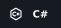
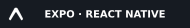
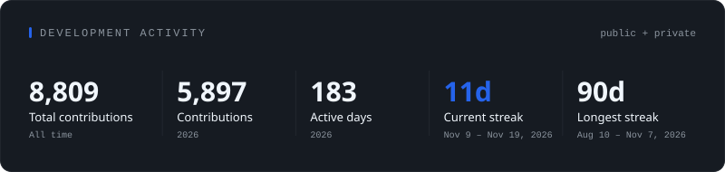
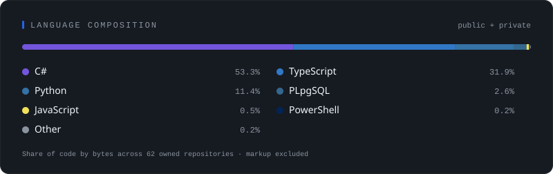

<!--
  GitHub profile README for Thejoshuajose.
  Owner: FIWB Solutions LLC · Author: Joshua Gonzales.
  Setup, placeholders and maintenance: docs/SETUP.md
-->

  

  <b>Full-stack developer at FIWB Solutions LLC.</b> 
  I take products from the first requirement to production and keep them running after launch.

  
  
  

 

## What I build

Most of my work is private software that real businesses run on every day. I own the whole path: the interface, the API, the data model, the deployment, and the support after launch.

- **Web:** React and TypeScript front ends on APIs and databases I design myself
- **APIs:** REST services in FastAPI and ASP.NET Core, with JWT and passkey authentication
- **Mobile:** native apps in .NET MAUI and Expo
- **Desktop:** .NET tools for Windows and macOS that keep working offline
- **Cloud:** AWS hosting, secrets, DNS and TLS, shipped through GitHub Actions
- **Games:** Roblox games written in Luau

## Stack

<table>
  <tr>
    <th align="left" valign="top">Frontend</th>
    <td>
      
      
      
      
      
      
      
      
      
      
    </td>
  </tr>
  <tr>
    <th align="left" valign="top">Backend</th>
    <td>
      
      
      
      
      
    </td>
  </tr>
  <tr>
    <th align="left" valign="top">Mobile</th>
    <td>
      
      
    </td>
  </tr>
  <tr>
    <th align="left" valign="top">Desktop</th>
    <td>
      
      
      
    </td>
  </tr>
  <tr>
    <th align="left" valign="top">Games</th>
    <td>
      
    </td>
  </tr>
  <tr>
    <th align="left" valign="top">Data</th>
    <td>
      
      
      
      
    </td>
  </tr>
  <tr>
    <th align="left" valign="top">Testing</th>
    <td>
      
      
      
    </td>
  </tr>
  <tr>
    <th align="left" valign="top">Cloud and DevOps</th>
    <td>
      
      
      
      
    </td>
  </tr>
</table>

## Currently building

- Customer portals and admin tools on React and Supabase, for web and native mobile
- Passkey-first authentication across APIs and mobile apps
- Offline desktop tooling in .NET
- Tighter CI, dependency pinning and deployment workflows

## Activity

<picture>
  <source media="(prefers-color-scheme: dark)" srcset="https://raw.githubusercontent.com/Thejoshuajose/Thejoshuajose/stats/activity-dark.svg" />
  <source media="(prefers-color-scheme: light)" srcset="https://raw.githubusercontent.com/Thejoshuajose/Thejoshuajose/stats/activity.svg" />
  
</picture>

<picture>
  <source media="(prefers-color-scheme: dark)" srcset="https://raw.githubusercontent.com/Thejoshuajose/Thejoshuajose/stats/languages-dark.svg" />
  <source media="(prefers-color-scheme: light)" srcset="https://raw.githubusercontent.com/Thejoshuajose/Thejoshuajose/stats/languages.svg" />
  
</picture>

<picture>
  <source media="(prefers-color-scheme: dark)" srcset="https://raw.githubusercontent.com/Thejoshuajose/Thejoshuajose/output/github-contribution-grid-snake-dark.svg" />
  <source media="(prefers-color-scheme: light)" srcset="https://raw.githubusercontent.com/Thejoshuajose/Thejoshuajose/output/github-contribution-grid-snake.svg" />
  
</picture>

Cards are generated daily from the GitHub API by this repository's own workflows. They count private work, so the numbers are higher than what the public repositories alone would show.

## Contact

Have something to build? I take on full-stack products, APIs and cloud work, from first idea to production.

  
  
  

